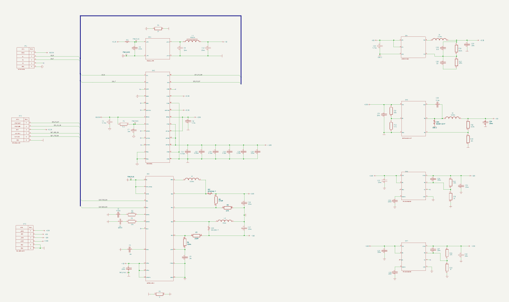
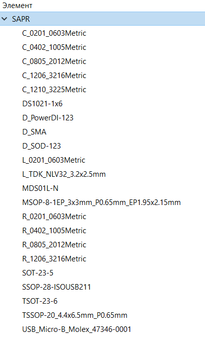
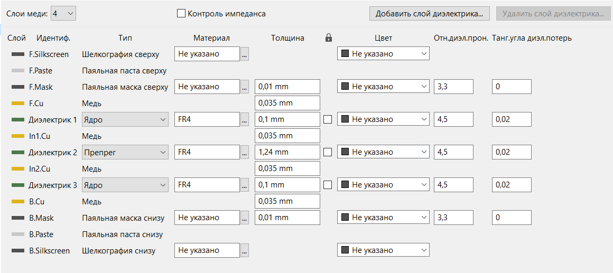
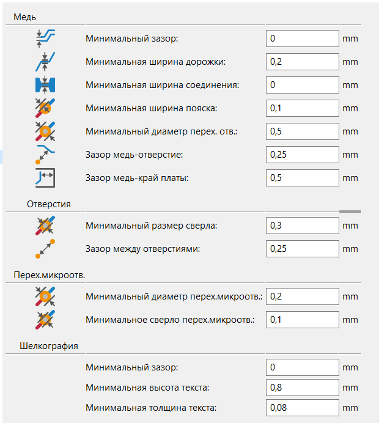

# Отчет по Домашнему заданию: Разработка печатной платы блока питания
**Выполнила: Генина Е.И.**
**Группа: БМТ2-31М**
**Дисциплина: САПР электронных стредств**
Среда разработки: KiCad 10.0

**1. Описание проекта**
В рамках данного проекта была разработана печатная плата блока питания. Устройство предназначено для питания электроимпедансного томографа для функциональной диагностики мышц.
На вход платы подается неразвязанное напряжение +5В (от внешнего источника питания, например, от ноутбука). С помощью рассматриваемой схемы генерируются следующие выходные напряжения:

+3.3В (для цифровых цепей);
+5В (развязанное для аналоговых цепей);
+15В и -15В (для аналоговых цепей).

Основу схемы составляют преобразователи и регуляторы напряжения:

ADP5071 — двухканальный DC-DC преобразователь с генерацией положительного и отрицательного напряжений.

ISOUSB211 — изолированный повторитель USB 2.0 (обеспечивает развязку).

TPS7A49 и TPS7A30 — малошумящие линейные регуляторы для формирования напряжений +15В и -15В.

**2. Библиотека компонентов и Git-сабмодуль**
Библиотека компонентов была вынесена в отдельный репозиторий и подключена к основному проекту как git-сабмодуль. Это обеспечивает независимое версионирование и переиспользование.

Символы (УГО): Файл UGO.kicad_sym. УГО оформлены по ГОСТ.

Посадочные места: Папка SAPR.pretty.

Партномеры: В свойствах каждого компонента заполнено поле Manufacturer_Part_Number с партномерами.

Пути: В настройках KiCad используются относительные пути с применением переменной ${KIPRJMOD} (${KIPRJMOD}/libs/kicad-library/UGO.kicad_sym;${KIPRJMOD}/libs/kicad-library/SAPR.pretty).

Все посадочные места были проверены на соответствие даташитам. Для стандартных компонентов (резисторы, конденсаторы) использовались стандартные футпринты, для специфических — специализированные из базы производителя, отстутствующие посадочные места были созданы самостоятельно. 3D-модели привязаны и корректно отображаются.

**3. Принципиальная схема (Э3)**
Схема электрическая принципиальная оформлена на листе формата А3 согласно ГОСТ.

Классы цепей: Был создан класс Power (фиолетовый цвет, стиль линии — штрихи). В этот класс включены все цепи питания. Остальные цепи относятся к классу Default.

Ширина дорожек для класса Power задана как 0.4 мм, однако при трассировке преимущественно использовались полигоны (зоны).

**4. Файл печатной платы**
Плата спроектирована в 4 слоя с учетом технологических ограничений производства «Резонит».

Стек слоев (Board Stackup):
F.Cu (Верхний слой) — 0.035 мм
Диэлектрик 1 (Prepreg) — 0.1 мм
In1.Cu (Внутренний 1) — 0.035 мм
Диэлектрик 2 (Ядро, FR4) — 1.24 мм
In2.Cu (Внутренний 2) — 0.035 мм
Диэлектрик 3 (Prepreg) — 0.1 мм
B.Cu (Нижний слой) — 0.035 мм

Технологические нормы (Constraints):
Minimum clearance (Мин. зазор)	0.20 мм

Copper to edge clearance (Зазор от меди до края) 0.50 мм

Minimum track width (Мин. ширина дорожки) 0.20 мм

Minimum annular width (Мин. кольцо меди) 0.15 мм

Minimum drill size (Мин. диаметр сверления)	0.30 мм

Hole to hole distance (Расстояние между отверстиями)	0.20 мм

Copper to hole clearance (Зазор медь-отверстие)	0.25 мм

Minimum text height (Мин. высота текста)	1.0 мм

Minimum text thickness (Мин. толщина линии)	0.15 мм

Silk to soldermask clearance (Зазор шелкография-маска)	0.10 мм

Soldermask expansion (Расширение маски)	0.05 мм

Minimum connection width (Мин. ширина соединения)	0.20 мм

Thermal relief spoke count (Кол-во спиц развязки)	4

Зазор медь-край платы: 0.4 мм

Использованы переходные отверстия диаметром 0,3/0.6 мм (со сверлом 0.3 мм).

**5. Автоматизация сборки**
Для автоматизации процесса проверки и подготовки производственных файлов в корне проекта (путь D:\Univ\САПР ЭС\Project_sapr) расположен скрипт build.bat.

Скрипт использует утилиту kicad-cli и выполняет следующие действия:

ERC — Проверка электрических правил схемы (учитывает предупреждения).

DRC — Проверка правил проектирования печатной платы (учитывает предупреждения).

Gerber + Excellon — Генерация файлов для производства.

BOM — Генерация перечня элементов в формате CSV.

PDF — Экспорт схемы в PDF.

**6. Инструкция по развертыванию проекта**
Для того чтобы скачать проект вместе с библиотекой, необходимо использовать следующую команду:

git clone --recursive https://github.com/Katerrrina-g/Project_SAPR.git